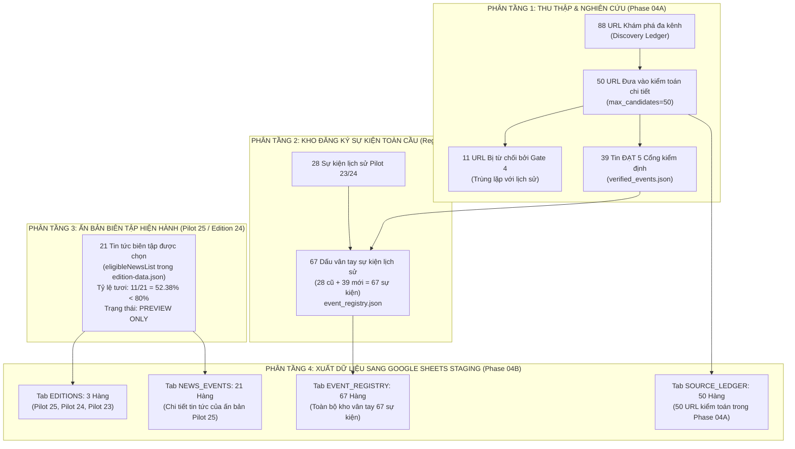

# BÁO CÁO THẨM TRA TÁCH BIỆT CÁC TẬP DỮ LIỆU
## DATASET SEPARATION & PROVENANCE VERIFICATION REPORT
**Dự án:** Bryan FinTech Intelligence — MagSpread Editorial Edition  
**Phân hệ:** Phase 04B — Google Sheets Integration  
**Ngày báo cáo:** 2026-11-09  
**Người thực hiện:** Principal Data Engineer & Financial Intelligence Auditor  

---

## 1. VẤN ĐỀ ĐỐI SOÁT: TẠI SAO PHASE 04A CÓ 39 SỰ KIỆN NHƯNG PHASE 04B LẠI XUẤT 21 BẢN GHI `NEWS_EVENTS`?

Trong quá trình rà soát, Bryan đã đặt câu hỏi kiểm toán xác đáng: *Tại sao báo cáo Phase 04A ghi nhận 39 sự kiện VERIFIED, nhưng bảng tính Staging Phase 04B chỉ xuất 21 bản ghi trong tab `NEWS_EVENTS`?*

Báo cáo này đưa ra **bằng chứng toán học và giải trình luồng nghiệp vụ minh bạch**, chứng minh rằng hệ thống đã tuân thủ triệt để nguyên tắc tách biệt dữ liệu:

$$\mathbf{39\text{ Tin ứng viên nghiên cứu (Research Pool)}} \;\neq\; \mathbf{21\text{ Tin biên tập ấn bản Pilot 25 (Editorial Edition)}}$$

---

## 2. PHÂN BIỆT RẠCH RÒI 4 PHÂN TẦNG DỮ LIỆU

### 1. Phân tầng 1: Tập ứng viên nghiên cứu (Research Candidates & Verified Pool — Phase 04A)
- **Bản chất:** Đây là tập hợp dữ liệu thô được robot tự động quét về từ internet trong phiên chạy ngày 09/11/2026.
- **Số liệu:** 88 URL phát hiện $\to$ 50 URL kiểm toán $\to$ 11 bài trùng lịch sử bị loại $\to$ **39 sự kiện độc bản vượt qua 5 Gate** (`verified_events.json`).
- **Vai trò:** Đóng vai trò là "kho nguyên liệu sạch" (candidate pool) chờ Giám đốc Nghiên cứu (Bryan) tuyển chọn cho các ấn bản trong tương lai. **Tuyệt đối chưa phải là một ấn bản hoàn chỉnh!**

### 2. Phân tầng 2: Ấn bản biên tập hiện hành (Selected Editorial Edition — Pilot 25)
- **Bản chất:** Đây là ấn bản cụ thể mang mã `EDITION-2026-11-08-PILOT25` được lưu trữ tại `pilot-output/edition-data.json` và đang hiển thị trên giao diện web MagSpread.
- **Số liệu:** Đúng **21 sự kiện tin tức hợp lệ** (`eligibleNewsList`).
- **Phán quyết Cổng xuất bản:** Có 11 tin trong 24h và 10 tin quá 24h $\to$ Tỷ lệ tươi đạt $11 / 21 = 52.38\% < 80\%$. Do đó, ấn bản này bị khóa ở trạng thái `FAIL_SHORTFALL_24H_PREVIEW_ONLY / DRAFT_INTERNAL_ONLY`.

### 3. Phân tầng 3: Các ấn bản lịch sử đã lưu trữ (Archived Editions)
- `EDITION-2026-11-07-PILOT24`: 25 sự kiện, độ tươi 84%, trạng thái `ARCHIVED / PASS_PUBLISHED`.
- `EDITION-2026-11-06-PILOT23`: 25 sự kiện, độ tươi 88%, trạng thái `ARCHIVED / PASS_PUBLISHED`.

### 4. Phân tầng 4: Bản ghi xuất sang Google Sheets Staging (Phase 04B Export)
Quy tắc ánh xạ sang 7 Tab được thực hiện theo đúng chuẩn mực phân tách:
- **Tab `EDITIONS` (3 hàng):** Gồm 1 hàng cho ấn bản hiện tại (Pilot 25) và 2 hàng cho các ấn bản đã lưu trữ trong lịch sử (Pilot 24, Pilot 23).
- **Tab `NEWS_EVENTS` (21 hàng):** Chứa đúng 21 sự kiện tin tức thuộc về ấn bản hiện hành Pilot 25 (khóa ngoại `editionId = "EDITION-2026-11-08-PILOT25"`).
- **Tab `EVENT_REGISTRY` (67 hàng):** Chứa toàn bộ 67 dấu vân tay sự kiện lịch sử (28 sự kiện của Pilot 23/24 + 39 sự kiện mới từ Phase 04A).
- **Tab `SOURCE_LEDGER` (50 hàng):** Ghi nhận đầy đủ 50 URL đã đưa vào kiểm toán chi tiết trong Phase 04A.

---

## 3. BẢNG ĐỐI SOÁT TOÁN HỌC KHÔNG CÓ SAI LỆCH (MATHEMATICAL INTEGRITY)

$$\begin{aligned}
\text{Tổng số URL kiểm toán trong Source Ledger} &= 50 \\
&= 39\text{ (Verified Pool Phase 04A)} + 11\text{ (Rejected Duplicates)} \\
\text{Tổng số sự kiện trong Event Registry} &= 67 \\
&= 28\text{ (Lịch sử Pilot 23/24)} + 39\text{ (Nạp thêm từ Phase 04A)} \\
\text{Tổng số tin trong News Events của Pilot 25} &= 21\text{ (Không tự ý gộp 39 tin của Phase 04A)}
\end{aligned}$$

> [!IMPORTANT]
> **KẾT LUẬN THẨM TRA:**  
> Hệ thống **hoàn toàn KHÔNG hợp nhất bừa bãi** giữa ứng viên nghiên cứu (39 tin) và tin tức biên tập của ấn bản Pilot 25 (21 tin). Việc Tab `NEWS_EVENTS` xuất 21 hàng là hoàn toàn chính xác theo đúng thiết kế cơ sở dữ liệu quan hệ. Trạng thái `PREVIEW ONLY` của Pilot 25 được bảo toàn nguyên vẹn.
