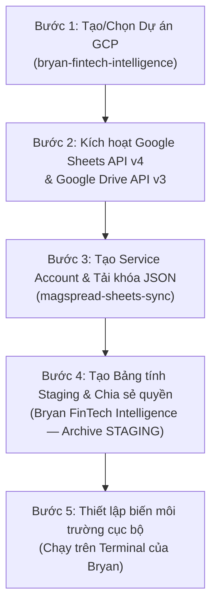

# HƯỚNG DẪN THIẾT LẬP GOOGLE CLOUD SERVICE ACCOUNT
## GOOGLE CLOUD & SHEETS STAGING SETUP GUIDE FOR BRYAN
**Dự án:** Bryan FinTech Intelligence — MagSpread Editorial Edition  
**Phân hệ:** Phase 04B — Google Sheets Integration (Live Preparation)  
**Ngày phát hành:** 2026-11-09  
**Người lập:** Principal Cloud Infrastructure & Security Auditor  

---

## 1. MỤC TIÊU VÀ NGUYÊN TẮC BẢO MẬT TỐI CAO

Hướng dẫn này cung cấp quy trình chuẩn từng bước để Bryan cấu hình môi trường Google Cloud an toàn, cấp quyền cho bộ đồng bộ dữ liệu `sheets_sync_engine.py` kết nối tới một Bảng tính Staging thử nghiệm duy nhất.

### 4 Nguyên tắc an toàn bắt buộc:
1. **Quyền hạn tối thiểu (Principle of Least Privilege):** Service Account chỉ được cấp quyền chỉnh sửa (`Editor`) trên **DUY NHẤT** một bảng tính Staging thử nghiệm. Tuyệt đối không cấp quyền cấp dự án (Project Owner / Editor).
2. **Không commit vào Git:** Tệp khóa JSON tải về máy phải được lưu trữ ở thư mục người dùng cá nhân (ví dụ: `~/.config/gcp/`), tuyệt đối không copy vào thư mục mã nguồn dự án `Bryan-Portfolio-Antigravity/`.
3. **Không gửi qua chat:** Tuyệt đối không copy nội dung tệp khóa JSON dán vào khung chat AI.
4. **Bảng tính Staging độc lập:** Tên bảng tính bắt buộc phải là `Bryan FinTech Intelligence — Archive STAGING`. Tuyệt đối không kết nối vào bất kỳ bảng tính thực tế nào đang phục vụ vận hành.

---

## 2. QUY TRÌNH THIẾT LẬP 4 BƯỚC CHO BRYAN



---

### BƯỚC 1: TẠO HOẶC CHỌN DỰ ÁN TRÊN GOOGLE CLOUD
1. Đăng nhập vào [Google Cloud Console](https://console.cloud.google.com/) bằng tài khoản Google của Bryan.
2. Tạo một Dự án mới (hoặc chọn dự án có sẵn):
   - **Tên dự án:** `bryan-fintech-intelligence`
   - **Project ID:** (Ví dụ: `bryan-fintech-intel-2026`)

---

### BƯỚC 2: KÍCH HOẠT CÁC API BẮT BUỘC
1. Vào thanh tìm kiếm trên cùng của Cloud Console, gõ **Google Sheets API** $\to$ Bấm **Enable (Kích hoạt)**.
2. Tiếp tục tìm kiếm **Google Drive API** $\to$ Bấm **Enable (Kích hoạt)**.  
   *(Google Drive API cần thiết để kiểm tra quyền truy cập tệp và quản lý metadata).*

---

### BƯỚC 3: TẠO SERVICE ACCOUNT VÀ KHÓA BẢO MẬT
1. Vào menu bên trái: **IAM & Admin (IAM & Quản trị)** $\to$ **Service Accounts (Tài khoản dịch vụ)**.
2. Bấm nút **+ Create Service Account (Tạo tài khoản dịch vụ)**:
   - **Tên hiển thị:** `magspread-sheets-sync`
   - **Service Account ID:** `magspread-sheets-sync`
   - **Mô tả:** `Service account for MagSpread staging archive integration`
   - Bấm **Create and Continue**.
   - Mục *Grant this service account access to project*: **BỎ TRỐNG (Không cần cấp quyền cấp dự án)**.
   - Bấm **Done**.
3. Sao chép lại địa chỉ email của Service Account vừa tạo, có dạng:  
   `magspread-sheets-sync@<PROJECT_ID>.iam.gserviceaccount.com`
4. Nhấp vào Service Account vừa tạo $\to$ Chọn tab **Keys (Khóa)**:
   - Bấm **Add Key (Thêm khóa)** $\to$ **Create new key (Tạo khóa mới)**.
   - Chọn định dạng: **JSON** $\to$ Bấm **Create**.
   - Trình duyệt sẽ tải về một tệp khóa JSON.
5. **Lưu trữ tệp khóa:**
   - Mở Terminal trên máy Mac của Bryan, di chuyển tệp khóa vào thư mục an toàn ngoài Git:
     ```bash
     mkdir -p ~/.config/gcp
     mv ~/Downloads/bryan-fintech-intel-*.json ~/.config/gcp/bryan_sheets_sa.json
     chmod 600 ~/.config/gcp/bryan_sheets_sa.json
     ```

---

### BƯỚC 4: TẠO BẢNG TÍNH STAGING VÀ PHÂN QUYỀN TRUY CẬP
1. Truy cập [Google Sheets](https://sheets.google.com/) và tạo một Bảng tính mới trống:
   - **Tên bảng tính:** `Bryan FinTech Intelligence — Archive STAGING`
2. Tạo trước 7 Tab theo đúng định danh (hoặc để công cụ tự động sinh):
   - `EDITIONS`
   - `NEWS_EVENTS`
   - `EDITORIAL_SECTIONS`
   - `MARKET_PULSE_HISTORY`
   - `EVENT_REGISTRY`
   - `SOURCE_LEDGER`
   - `PUBLISH_AUDIT`
3. Nhấp vào nút **Share (Chia sẻ)** ở góc trên bên phải:
   - Nhập email của Service Account ở Bước 3:  
     `magspread-sheets-sync@<PROJECT_ID>.iam.gserviceaccount.com`
   - Phân quyền: **Editor (Người chỉnh sửa)**.
   - Bỏ tích ô *"Notify people"* (Thông báo cho người khác) $\to$ Bấm **Share**.
4. Lấy mã `SPREADSHEET_ID` từ thanh địa chỉ:
   ```
   https://docs.google.com/spreadsheets/d/1A2B3C4D5E6F7G8H9I0J_kLMNOPQRSTUVWXYZ/edit
                                          ▲▲▲▲▲▲▲▲▲▲▲▲▲▲▲▲▲▲▲▲▲▲▲▲▲▲▲▲▲▲
                                          Đây chính là SPREADSHEET_ID
   ```

---

### BƯỚC 5: CẤU HÌNH BIẾN MÔI TRƯỜNG TRƯỚC KHI CHẠY THỬ
Khi Bryan đã hoàn tất 4 bước trên và sẵn sàng cho phép chạy bài kiểm tra Live Test có kiểm soát (Live Smoke Test), Bryan chỉ cần gõ 2 lệnh sau trong Terminal (không commit vào code):

```bash
export GOOGLE_APPLICATION_CREDENTIALS="$HOME/.config/gcp/bryan_sheets_sa.json"
export GOOGLE_SHEETS_SPREADSHEET_ID="<SPREADSHEET_ID_CUA_BRYAN>"
```

Sau đó thông báo cho Agent để tiến hành bài kiểm tra Live Smoke Test theo đúng quy trình tại `LIVE_API_TEST_PLAN.md`.
