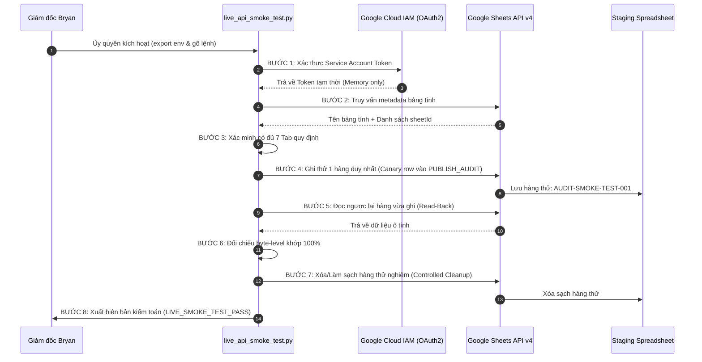

# KẾ HOẠCH KIỂM THỬ KẾT NỐI API THỰC TẾ CÓ KIỂM SOÁT
## CONTROLLED LIVE GOOGLE SHEETS API TEST PLAN
**Dự án:** Bryan FinTech Intelligence — MagSpread Editorial Edition  
**Phân hệ:** Phase 04B — Google Sheets Integration (Live Testing Protocol)  
**Tình trạng kích hoạt:** `DISABLED / AWAITING_BRYAN_AUTHORIZATION`  
**Ngày lập kế hoạch:** 2026-11-09  
**Người lập:** Principal QA Lead & Security Auditor  

---

## 1. NGUYÊN TẮC AN TOÀN TUYỆT ĐỐI CHO LIVE TEST

Khi Bryan đã hoàn tất cấu hình GCP Service Account và cấp `SPREADSHEET_ID`, bài kiểm thử trực tiếp này **CHỈ ĐƯỢC PHÉP CHẠY MỘT LẦN DUY NHẤT DƯỚI DẠNG SMOKE TEST CÓ KIỂM SOÁT (Scoped Canary Smoke Test)**.

### Các điều cấm tuyệt đối:
- **CẤM ghi toàn bộ 155 hàng ngay lập tức:** Không được thực hiện full sync ngay lần đầu kết nối.
- **CẤM ghi vào bảng tính Production:** Chỉ cho phép ghi vào bảng tính Staging riêng biệt có tiêu đề `Bryan FinTech Intelligence — Archive STAGING`.
- **CẤM để lại rác thử nghiệm:** Mọi hàng thử nghiệm phải được dọn dẹp (cleanup) ngay sau khi đối soát xong.

---

## 2. KỊCH BẢN KIỂM THỬ 8 BƯỚC TUẦN TỰ (8-STEP CONTROLLED PROTOCOL)



---

### BƯỚC 1: XÁC THỰC SERVICE ACCOUNT AN TOÀN (SAFE AUTHENTICATION)
- **Hành động:** Nạp tệp khóa `GOOGLE_APPLICATION_CREDENTIALS` qua thư viện `google.oauth2.service_account`.
- **Phạm vi quyền tối thiểu yêu cầu (Scopes):**
  - `https://www.googleapis.com/auth/spreadsheets`
  - `https://www.googleapis.com/auth/drive.file`
- **Tiêu chuẩn nghiệm thu:** Sinh được Access Token tạm thời trong bộ nhớ RAM mà không in nội dung private key ra màn hình terminal.

---

### BƯỚC 2: TRUY VẤN METADATA BẢNG TÍNH (METADATA RETRIEVAL)
- **Hành động:** Gọi API `spreadsheets.get(spreadsheetId=...)`.
- **Tiêu chuẩn nghiệm thu:**
  - Tiêu đề bảng tính phải chứa chuỗi: `Bryan FinTech Intelligence — Archive STAGING`.
  - Nếu tiêu đề không khớp (ví dụ: phát hiện kết nối nhầm vào bảng tính Production), tiến trình **LẬP TỨC DỪNG KHẨN CẤP (ABORT)**.

---

### BƯỚC 3: KIỂM TRA ĐỦ 7 TAB THEO SCHEMA (TAB VERIFICATION)
- **Hành động:** Kiểm tra danh sách sheets trong bảng tính.
- **Tiêu chuẩn nghiệm thu:** Có đầy đủ 7 tab theo đúng tên:
  `EDITIONS`, `NEWS_EVENTS`, `EDITORIAL_SECTIONS`, `MARKET_PULSE_HISTORY`, `EVENT_REGISTRY`, `SOURCE_LEDGER`, `PUBLISH_AUDIT`.
  *(Nếu bảng tính chưa có sẵn, script sẽ tự động tạo đủ 7 tab kèm dòng tiêu đề Header chuẩn).*

---

### BƯỚC 4: GHI MỘT HÀNG THỬ NGHIỆM DUY NHẤT (CANARY WRITE)
- **Hành động:** Ghi 1 hàng thử nghiệm duy nhất vào cuối tab `PUBLISH_AUDIT`:
  ```json
  {
    "auditLogId": "AUDIT-CANARY-SMOKE-TEST",
    "editionId": "EDITION-2026-11-08-PILOT25",
    "action": "LIVE_SMOKE_TEST",
    "performedBy": "BRYAN_INTELLIGENCE_QA_LEAD",
    "gateDecision": "PREVIEW_ONLY_SHORTFALL",
    "freshnessRatioRecorded": "52.38%",
    "verifiedCountRecorded": 21,
    "localJsonChecksum": "c95a591a4b695e51f980737d0f5c3a85e498023292c1c62e63daed0bf3dbe67a",
    "sheetsSyncStatus": "LIVE_CANARY_TEST_ROW",
    "rollbackReferenceCheckpoint": "CHECKPOINT-03-PHASE04A-ACCEPTED",
    "notes": "Temporary canary test record for connection validation. Will be cleaned up immediately.",
    "timestamp": "2026-11-09T00:44:00+07:00"
  }
  ```
- **Tiêu chuẩn nghiệm thu:** API trả về mã `updatedRows = 1`.

---

### BƯỚC 5: ĐỌC LẠI ĐỐI SOÁT (READ-BACK PARITY VERIFICATION)
- **Hành động:** Đọc lại đúng hàng vừa ghi từ Google Sheets bằng lệnh `spreadsheets.values.get`.
- **Tiêu chuẩn nghiệm thu:** Tất cả 12 trường dữ liệu đọc về phải khớp chính xác 100% với dữ liệu vừa gửi đi.

---

### BƯỚC 6: KIỂM TRA TÍNH LŨY THỪA (IDEMPOTENT REPEATED WRITE)
- **Hành động:** Gửi lại lệnh ghi hàng canary lần 2 với chế độ update theo khóa chính `AUDIT-CANARY-SMOKE-TEST`.
- **Tiêu chuẩn nghiệm thu:** Không được sinh ra 2 hàng trùng nhau trong bảng tính.

---

### BƯỚC 7: LÀM SẠCH HÀNG THỬ NGHIỆM (CONTROLLED CLEANUP)
- **Hành động:** Gọi lệnh xóa hàng canary vừa ghi, trả bảng tính về trạng thái nguyên sơ ban đầu.
- **Tiêu chuẩn nghiệm thu:** Hàng canary biến mất hoàn toàn, bảng tính không bị rác.

---

### BƯỚC 8: XUẤT BIÊN BẢN KIỂM TOÁN AN TOÀN (SAFETY LOGGING)
- **Hành động:** Ghi nhận thời gian đáp ứng (latency), tỷ lệ quota tiêu thụ, và xác nhận không có bất kỳ rò rỉ mã khóa bí mật nào.
- **Tiêu chuẩn nghiệm thu:** Xuất biên bản `LIVE_API_SMOKE_TEST_RESULT.json` và dừng lại chờ phê duyệt của Bryan trước khi tiến hành đồng bộ ấn bản chính thức.
