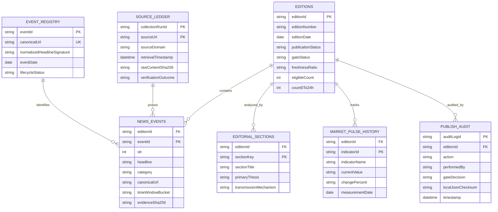

# KIẾN TRÚC TÍCH HỢP LƯU TRỮ GOOGLE SHEETS
## PHASE 04B ARCHITECTURE — STAGING ARCHIVAL SYSTEM
**Dự án:** Bryan FinTech Intelligence — MagSpread Editorial Edition  
**Phân hệ:** Phase 04B — Google Sheets Archive Integration (Controlled Staging)  
**Không gian làm việc:** `pilot-output/phase04b-sheets-staging/`  
**Ngày báo cáo:** 2026-11-09  
**Người thực hiện:** Principal Data Engineer & Release QA Lead  

---

## 1. MỤC TIÊU VÀ NGUYÊN TẮC KIẾN TRÚC CỐT LÕI

Mục tiêu của Phân hệ Phase 04B là thiết lập kiến trúc **Nguồn dữ liệu lưu trữ duy nhất đáng tin cậy (Single Archive Source of Truth)** trên nền tảng Google Sheets, kết nối tuần tự từ kết quả nghiên cứu Phase 04A qua khâu biên tập và xuất bản:

```
[Verified Events (Phase 04A)]
             │
             ▼
[Editorial Selection & Fact Grounding (25 Events Quota)]
             │
             ▼
[Publication Gate Evaluation (80% Freshness in 0–24h)]
             │
             ▼
[Approved Edition JSON (MagSpread Master Data)]
             │
             ▼
[SheetsSyncEngine (Deterministic 7-Tab Transformation)]
             │
             ▼
[Google Sheets Archival Database (7 Master Tabs)]
```

### Các nguyên tắc kiến trúc bất biến:
1. **Bảo tồn tuyệt đối giao diện MagSpread UI:** Tuyệt đối không nhúng mã kết nối Google API, OAuth token hay Service Account credential vào mã nguồn frontend (`magspread.js`, `magspread-preview.html`, `edition-data.js`).
2. **Tải dữ liệu phân tầng thông minh (Tiered Loading):** Giao diện web người dùng không tải toàn bộ lịch sử lưu trữ khi khởi tạo trang; chỉ tải mục lục chỉ mục siêu nhẹ (`archive_index.json`). Dữ liệu chi tiết của ấn bản cũ chỉ được kéo về khi người dùng nhấp chọn thông qua cơ chế đọc an toàn.
3. **Không ghi đè ấn bản đã xuất bản:** Mọi bản ghi thuộc ấn bản đã mang cờ `PUBLISHED` là bất biến. Tuyệt đối không tự động đánh dấu một bản xem trước (`PREVIEW ONLY`) thành bản xuất bản chính thức.
4. **Phân tách ranh giới an toàn (Air-Gapped Credentials):** Tác vụ đồng bộ Google Sheets chạy hoàn toàn ở môi trường backend/CLI có kiểm soát, lưu bằng chứng dạng mã băm SHA-256 thay vì đẩy tải trọng HTML nặng vào ô tính.

---

## 2. PHÂN LOẠI 7 TAB LƯU TRỮ VÀ MỐI QUAN HỆ KHÓA NGOẠI (ER DIAGRAM)



---

## 3. CƠ CHẾ PHỤC HỒI VÀ ĐỒNG BỘ NGUYÊN TỬ (ATOMICITY & RECOVERY)

Nếu quá trình ghi dữ liệu lên Google Sheets bị gián đoạn (do vượt quota 60 requests/phút, đứt kết nối mạng giữa chừng, hoặc lỗi định dạng hàng):
1. **Staging JSON Ledger (`staging_tables.json`):** Dữ liệu được chuyển đổi đầy đủ và kiểm tra hợp lệ 100% ở tầng staging trước khi gửi bất kỳ lệnh ghi nào lên cloud.
2. **Batch Request API:** Sử dụng `spreadsheets.values.batchUpdate` gửi theo khối thay vì ghi từng hàng đơn lẻ, giảm thiểu số lượng cuộc gọi mạng và nguy cơ dữ liệu dở dang.
3. **Mã băm kiểm chứng tính toàn vẹn (Integrity Checksum):** Mỗi phiên đồng bộ tạo một bản ghi trong `PUBLISH_AUDIT` lưu mã băm SHA-256 của `edition-data.json`, cho phép phát hiện tức thì bất kỳ sự sai lệch nào giữa bản nội bộ và đám mây.
4. **Phục hồi từ Checkpoint:** Nếu phát hiện dữ liệu trên Sheets bị lỗi, quản trị viên sử dụng `CHECKPOINT-03-PHASE04A-ACCEPTED` để khôi phục trạng thái ổn định đã nghiệm thu.
